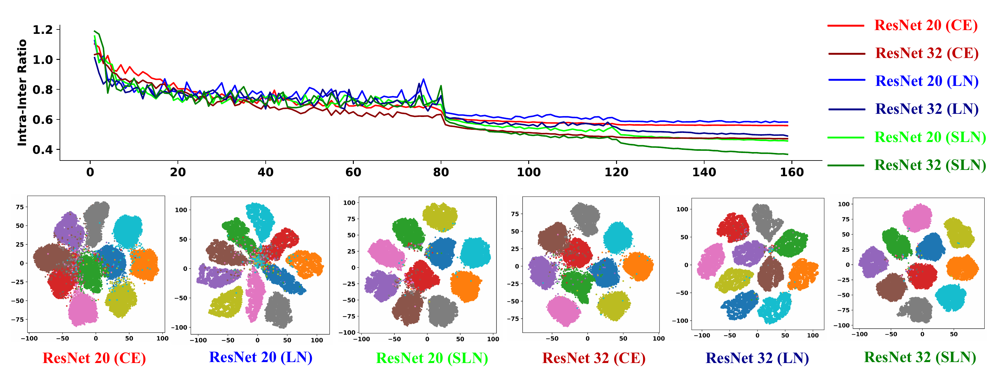

# Soft Logit Normalization (SLN)

Official code for the paper **"Soft Logit Normalization Loss: A Geometric Perspective on Loss Function Design"**.

SLN is a minimal, drop-in loss modification. It rescales the logits before the
softmax to

$$
\tilde{\mathbf f}=\frac{\mathbf f}{\tau\,\lVert\mathbf f\rVert_2^{\gamma}},
$$

and then applies the standard cross-entropy. The single new exponent
$\gamma$ interpolates between two well-known objectives:

| $\gamma$ | objective |
|---|---|
| $\gamma=0,\ \tau=1$ | standard Cross-Entropy (CE) |
| $\gamma=1$ | Logit Normalization (LN, [Wei et al. 2022](https://arxiv.org/abs/2203.11772)) |
| $0<\gamma<1$ | **Soft Logit Normalization (SLN)** |

Geometrically, the Jacobian of the SLN logit transform has a *tangential*
eigenvalue $1/(\tau\lVert\mathbf f\rVert_2^\gamma)$ and a *radial* eigenvalue
$(1-\gamma)/(\tau\lVert\mathbf f\rVert_2^\gamma)$, whose ratio is exactly
$1-\gamma$ — independent of the datapoint. LN ($\gamma=1$) deletes the radial
component entirely; SLN restores a controlled fraction $1-\gamma$ of it.

<p align="center">
  
</p>

*Trainable-feature toy example: a linear model on 2D points whose inputs are
themselves optimized. Features drift along the loss-induced directions
(here SLN). See [`toy_example/`](toy_example/).*

---

## Installation

```bash
git clone https://github.com/liuchongming1999/soft_logit_normalization.git
cd soft_logit_normalization
pip install -r requirements.txt
```

The core loss has **no other dependency than PyTorch** and can also be used
standalone (just copy [`sln/losses.py`](sln/losses.py)).

## Use SLN in your own training

```python
import torch
from sln import SLNLoss

criterion = SLNLoss(gamma=0.7, tau=0.2)   # tau = O(k^(-gamma/2)), k = #classes

for images, targets in train_loader:
    logits = model(images)                # raw logits
    loss = criterion(logits, targets)     # SLN cross-entropy
    loss.backward()
    optimizer.step()
```

If you already compute logits and prefer to transform them yourself:

```python
from sln import sln_logits
loss = torch.nn.functional.cross_entropy(sln_logits(logits, gamma=0.7, tau=0.2), targets)
```

`LogitNormalizationLoss(tau=0.04)` is provided as the $\gamma=1$ endpoint.

> **Choosing $\tau$.** The paper uses $\tau = O(k^{-\gamma/2})$ for $k$
> classes so that the transformed logits start in a well-conditioned range:
> $\tau=0.2$ for CIFAR-10 ($k=10$), $\tau=0.08$ for CIFAR-100 ($k=100$) and
> $\tau=0.2$ (SLN) / $0.04$ (LN) for ImageNet-1K and GLUE. We use
> $\gamma=0.7$ throughout, selected on CIFAR-10 and transferred unchanged.

---

## Repository structure

```
sln/            # the core SLN loss (importable, dependency-free except torch)
toy_example/    # 2D trainable-feature toy experiment + figures/gifs
cifar/          # CIFAR-10 / CIFAR-100 training (CE / LN / SLN, ResNet-20..110)
imagenet/       # ImageNet-1K training (timm-based, ResNet / ViT)
glue/           # GLUE fine-tuning (BERT / DeBERTa, CE / LN / SLN)
assets/         # figures used in this README
```

Each sub-directory has its own README with exact commands.

---

## Results

### CIFAR-10 / CIFAR-100 (ResNet, mean ± std over 10 runs)

| Model | Loss | CIFAR-10 | CIFAR-100 |
|---|---|---|---|
| ResNet-20 | CE | 91.81±0.15 | 67.26±0.18 |
| | LN | 92.05±0.10 | 67.33±0.16 |
| | **SLN** | **92.58±0.08** | **69.75±0.25** |
| ResNet-56 | CE | 93.07±0.17 | 70.19±0.22 |
| | LN | 93.16±0.21 | 70.32±0.19 |
| | **SLN** | **93.78±0.18** | **72.76±0.23** |
| ResNet-110 | CE | 93.64±0.16 | 70.84±0.31 |
| | LN | 93.67±0.20 | 71.03±0.20 |
| | **SLN** | **94.10±0.09** | **73.64±0.29** |

A ResNet-20 trained with SLN matches a ResNet-56 (~3× parameters) trained with
CE/LN; likewise ResNet-32+SLN ≈ ResNet-110+CE. Reproduce with
[`cifar/train.py`](cifar/).

<p align="center">
  
  
</p>

*Left: effect of the exponent $\gamma$ on CIFAR-10. Right: t-SNE of the
penultimate features (SLN gives the most compact classes).*

### ImageNet-1K (ResNet / ViT, top-1 %)

| Model | #Param | CE | LN | SLN |
|---|---|---|---|---|
| ResNet-50 | 26M | 76.8 | 78.1 | **79.2** |
| ResNet-101 | 45M | 78.6 | 79.4 | **80.5** |
| ResNet-152 | 60M | 78.9 | 79.9 | **81.0** |

ResNet-50+SLN (79.2%) surpasses the much larger ResNet-152+CE (78.9%).
Reproduce with [`imagenet/`](imagenet/).

<p align="center">
  
</p>

### GLUE (BERT, evaluation sets)

| Model | Loss | MNLI (m/mm) | QQP | QNLI | SST-2 | CoLA | MRPC | RTE | Avg |
|---|---|---|---|---|---|---|---|---|---|
| BERT-BASE | CE | 84.5/83.5 | 88.1 | 90.9 | 93.2 | 61.0 | 90.9 | 68.6 | 82.6 |
| | LN | 85.0/84.3 | 88.4 | 91.6 | 92.8 | 61.3 | 89.3 | 68.8 | 82.7 |
| | **SLN** | 85.0/84.9 | 88.5 | 91.7 | 93.5 | 63.9 | 91.4 | 71.7 | **83.8** |
| BERT-LARGE | CE | 86.2/85.5 | 88.6 | 92.4 | 93.7 | 62.3 | 91.2 | 72.3 | 84.0 |
| | LN | 86.5/86.1 | 88.8 | 92.6 | 93.2 | 62.7 | 90.2 | 73.9 | 84.2 |
| | **SLN** | 86.8/86.6 | 88.9 | 92.7 | 94.0 | 64.7 | 91.5 | 74.7 | **85.0** |

BERT-BASE+SLN reaches the average of BERT-LARGE (~3× parameters) trained with
CE/LN. Reproduce with [`glue/`](glue/).

---

## Citation

If you find this code useful, please cite:

```bibtex
@article{liu2026soft,
  title  = {Soft Logit Normalization Loss: A Geometric Perspective on Loss Function Design},
  author = {Liu, Chongming},
  year   = {2026}
}
```

## License

[MIT](LICENSE) © 2026 Chongming Liu (Truman)
