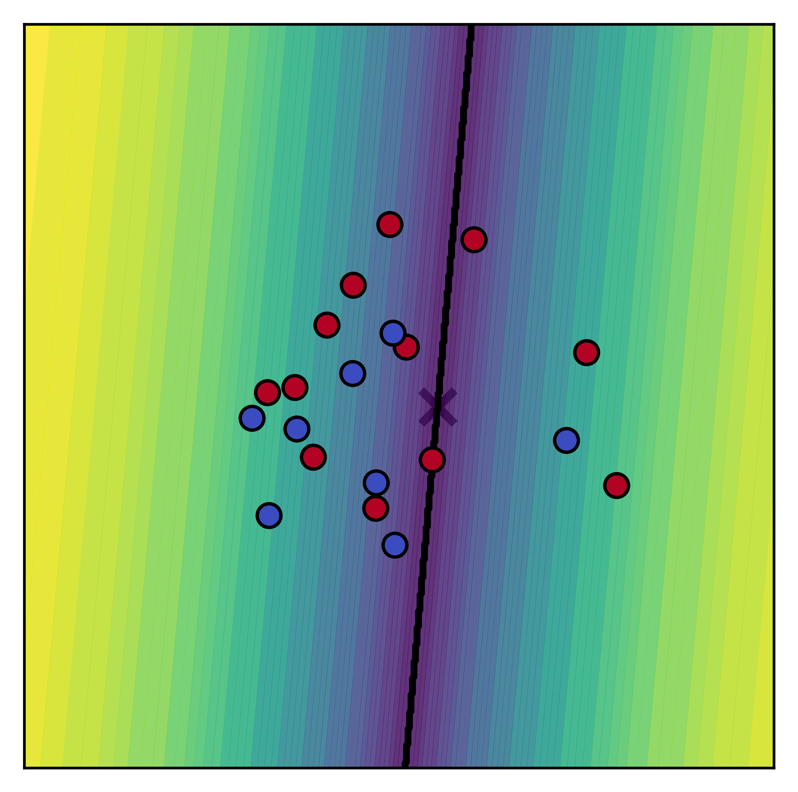
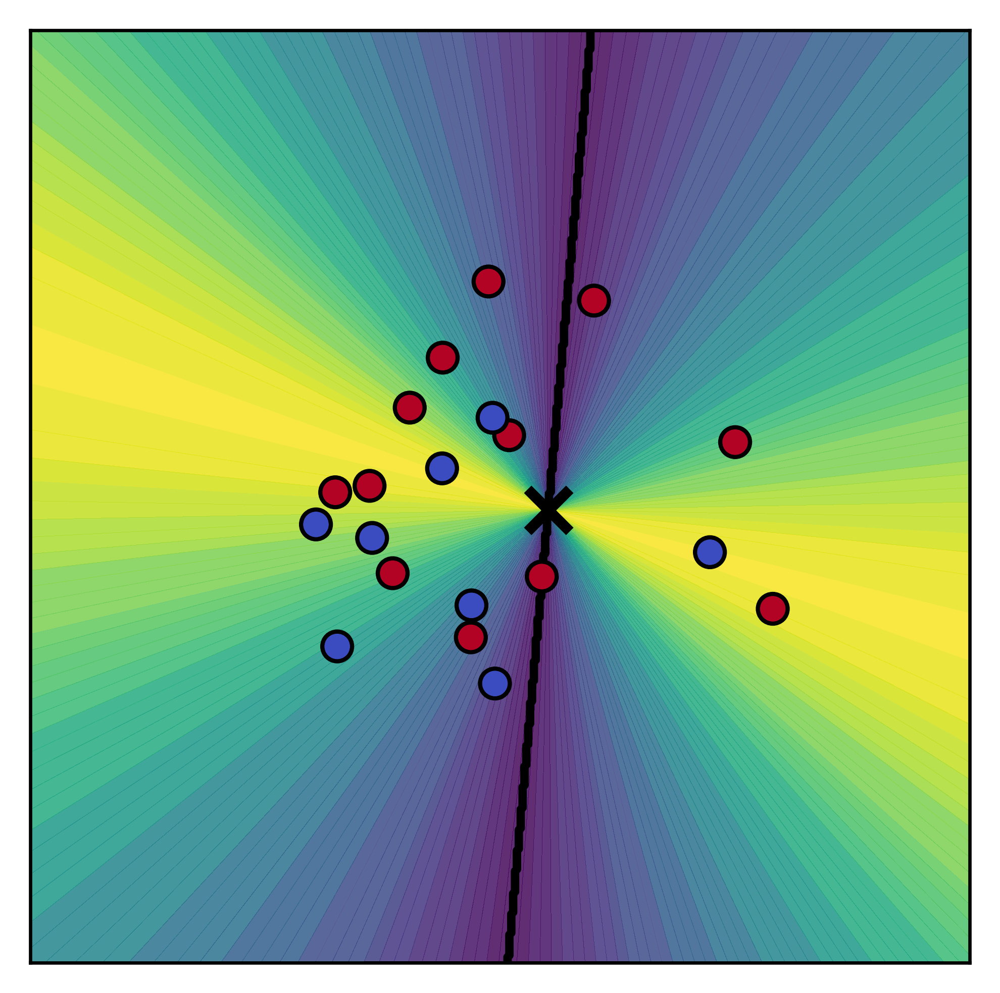
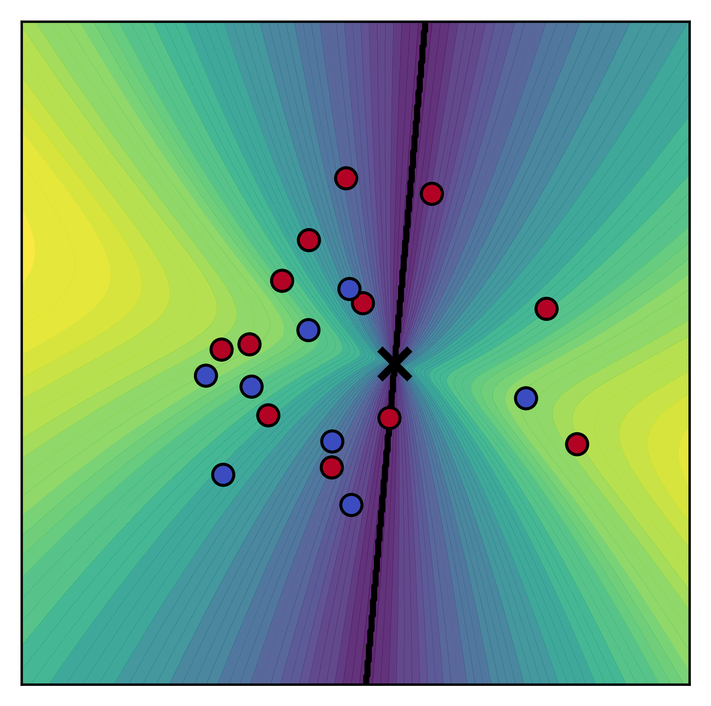

# Toy example: trainable-feature binary classification in 2D

This reproduces the conceptual experiment of the paper. A **single linear
layer** (2 → 2, no hidden layers) is used, and the 2D input points themselves
are treated as **trainable parameters** (the *trainable-feature* /
unconstrained-feature model). We then watch where the features drift under the
CE, LN and SLN losses.

The figures show, per loss, the per-point loss landscape (colour), the
decision boundary (black line), the stationary point $\mathbf{x}^*$ (cross),
and the feature trajectories over training.

## Run

```bash
python toy_example.py --loss sln --gamma 0.7 --tau 1.0
python toy_example.py --loss ce
python toy_example.py --loss ln
```

Outputs (to `--out-dir`, default `figures/`):

- `colorbar_<loss>.png` — final loss landscape + features
- `training_dynamics_<loss>.gif` — feature drift over epochs

Useful flags: `--num-samples`, `--num-epochs`, `--lr`, `--seed`, `--snap-every`.

## Results

| CE | LN | SLN |
|---|---|---|
|  |  |  |

Under CE the features are driven radially outward along fixed directions;
under LN they collapse onto a sphere (no radial component, $\gamma=1$); SLN
($\gamma=0.7$) keeps a controlled radial drift while separating the classes.
